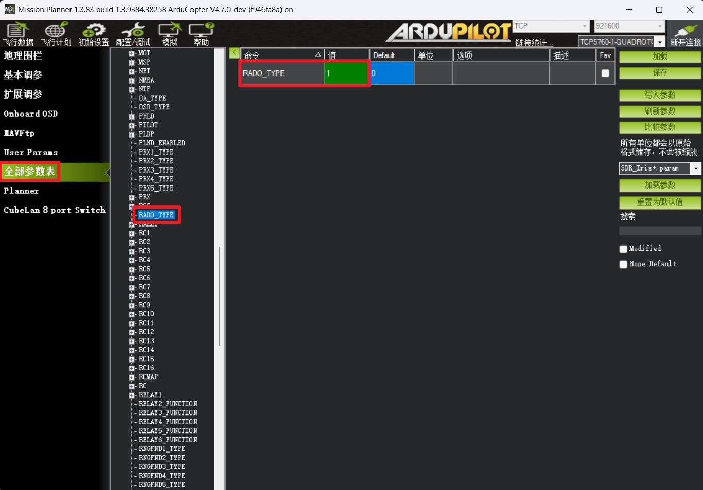
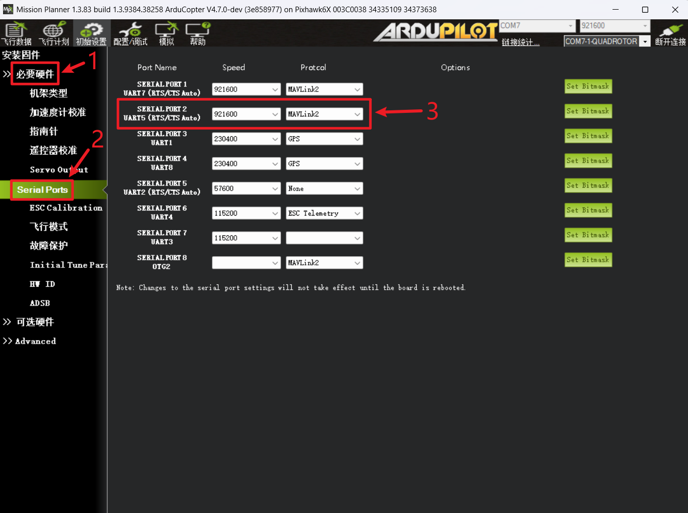
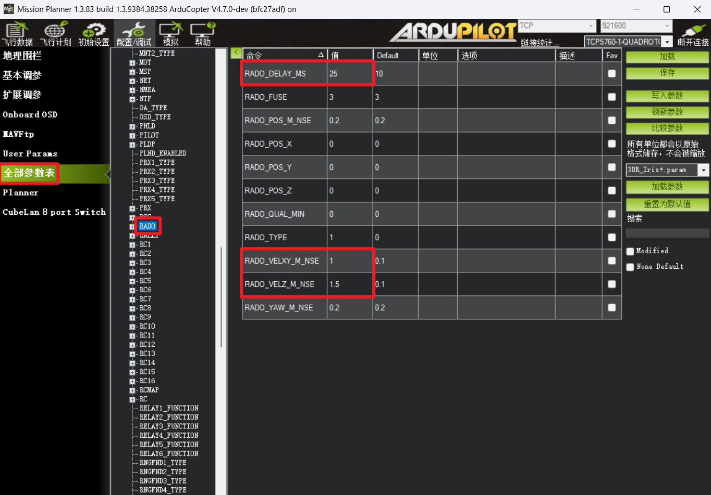
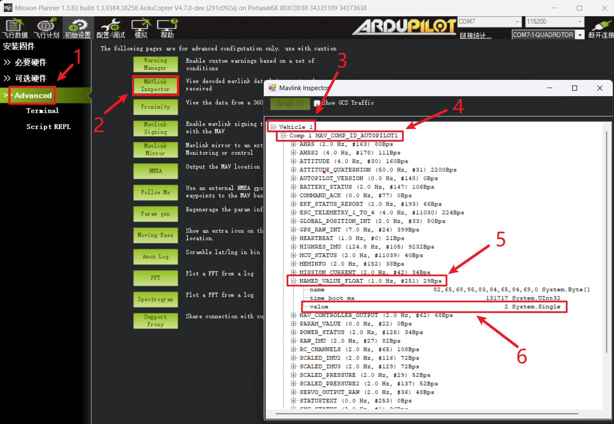
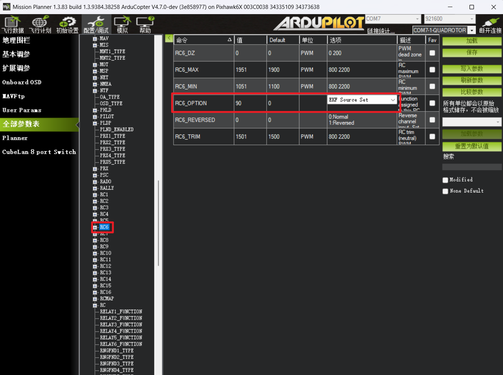
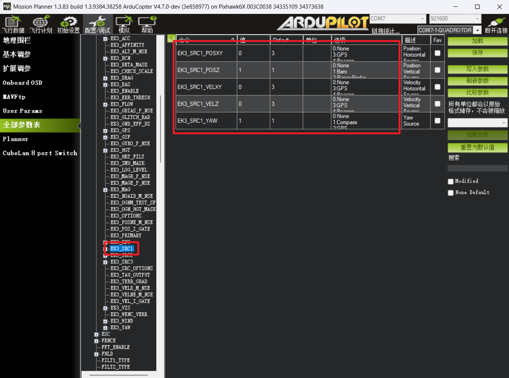
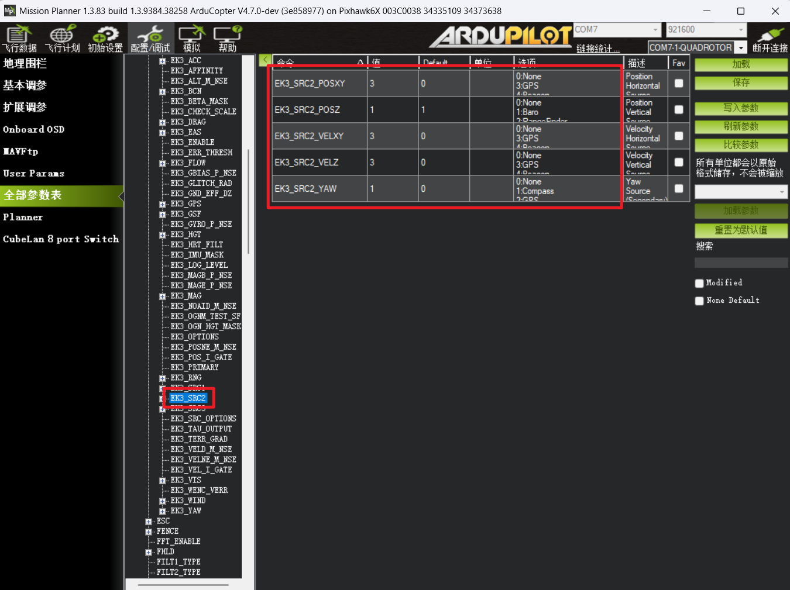
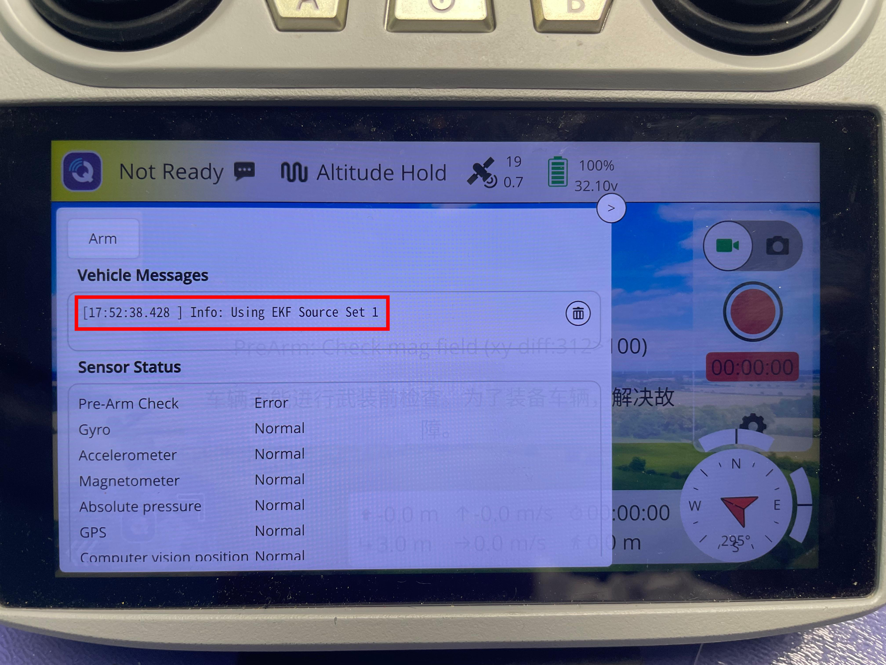
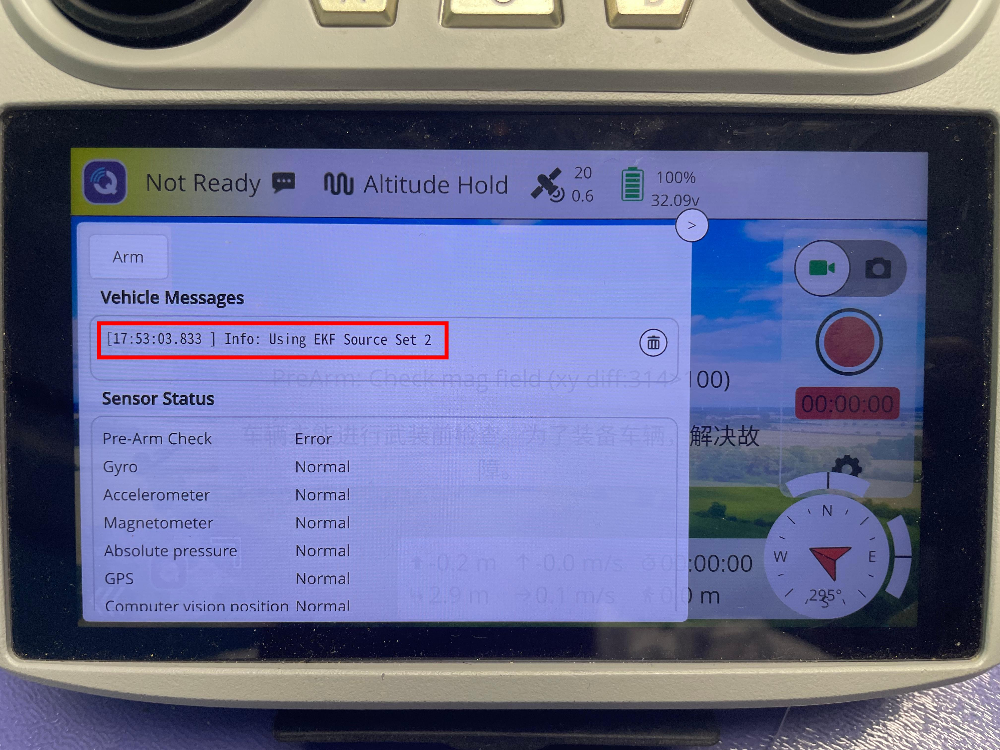
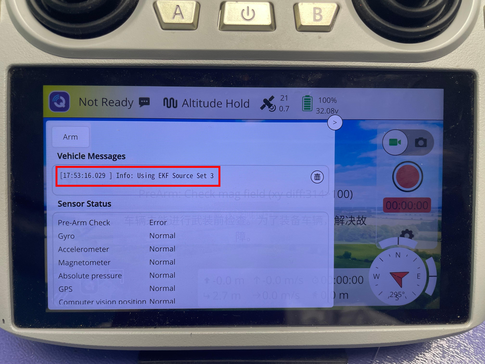

# ArduPilot集成雷达模块使用教程

## 1 项目简介

本项目基于**ArduPilot v4.7.0-dev**二次开发，用于集成雷达模块，可以实现无GNSS情况下的雷达定位功能。

## 2 飞控固件

在本仓库的**Releases页面**显示有目前已经自动编译生成的飞控固件，用户可以根据自己的飞控硬件型号，下载对应的飞控固件。以Holybro Pixhawk 6X为例，Releases页面对应的固件文件为Pixhawk6X_ArduCopter.apj。用户如需自己编译飞控固件，下载本仓库**release分支**的代码编译即可。

## 3 连接雷达

### 3.1 接线说明

飞控通过数传接口以MAVLink协议和雷达模块通信。以Holybro Pixhawk 6X飞控为例，选择飞控的**TELEM2**接口连接雷达模块，TELEM2接口对应的飞控串口为UART5。连接雷达模块时，需要连接以下三根线：
* 飞控的RX5连接雷达的TX1；
* 飞控的TX5连接雷达的RX1；
* 飞控的GND连接雷达的GND。

### 3.2 参数配置

首先启用雷达模块，如下图所示，将`RADO_TYPE`设置为`1`，写入参数后重启飞控，重新连接地面站并刷新参数列表，再进行以下配置。

TELEM2接口对应的是UART5，如下图所示，在Serial Ports页面找到SERIALPORT2（UART5），将Speed设置为921600，Protocol选择MAVLink2。

如下图所示，配置雷达导航融合参数，需要配置以下参数：
* `RADO_DELAY_MS = 25.0ms`；
* `RADO_VELXY_M_NSE = 1.00m/s`；
* `RADO_VELZ_M_NSE = 1.50m/s`。

### 3.3 检查飞控是否接收到雷达数据

如下图的步骤所示，依次点击：Advanced、MAVLink Inspector、Vehicle 1、Comp 1 MAV_COMP_ID_AUTOPILOT1、NAMED_VALUE_FLOAT，找到图中数字6指向的数值Value：
* **显示为2：表示飞控可以接收到雷达数据，且雷达数据有效**；
* 显示为1：表示飞控可以接收到雷达数据，但雷达数据无效；
* 显示为0：表示飞控没有接收到雷达数据。

## 4 配置GPS/雷达切换开关

### 4.1 配置切换开关

如下图所示，设置一个3段拨杆开关为“EKF观测源（EKF Source Set）”切换开关，这里以遥控通道6为例，也可设置为其它通道。

### 4.2 设置“EKF观测源”组合

第一个EKF观测源组合，对应三段拨杆的低位，表示采用**视觉定位**，按下图所示设置对应的参数，目前只配置了气压计、磁力计，**视觉定位不可用**。

第二个EKF观测源组合，对应三段拨杆的中间，表示采用**GPS定位**，按下图所示设置对应的参数，使用了GPS、气压计、磁力计。

第三个EKF观测源组合，对应三段拨杆的高位，表示采用**雷达定位**，按下图所示设置对应的参数，使用了雷达、气压计、磁力计。

### 4.3 验证GPS/雷达切换功能

* 拨杆开关位于**低位**：如下图所示，地面站显示信息“Info：Using EKF Source Set 1”，表示采用**视觉定位**。**当前没有加装视觉模块，视觉定位功能不可用**。

* 拨杆开关位于**中间**：如下图所示，地面站显示信息“Info：Using EKF Source Set 2”，表示采用**GPS定位**。

* 拨杆开关位于**高位**：如下图所示，地面站显示信息“Info：Using EKF Source Set 3”，表示采用**雷达定位**。

